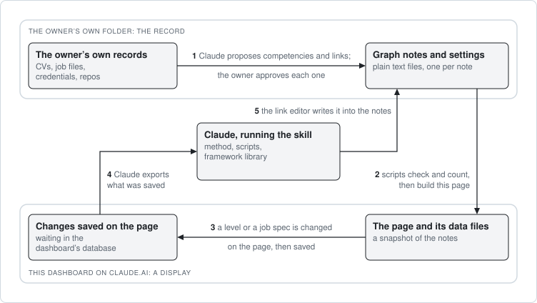
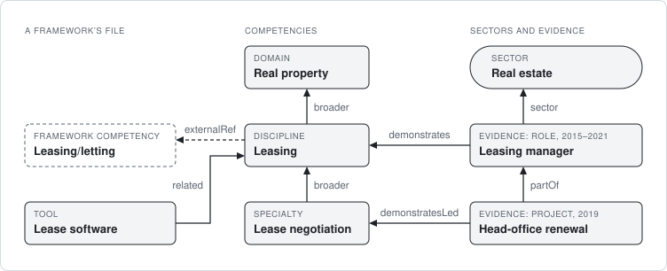
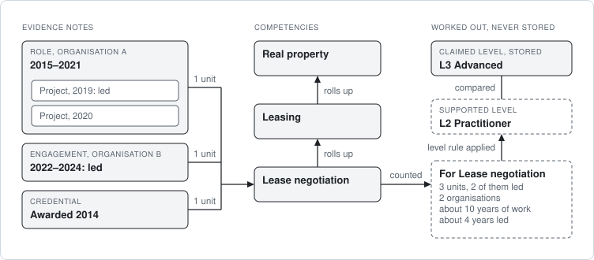
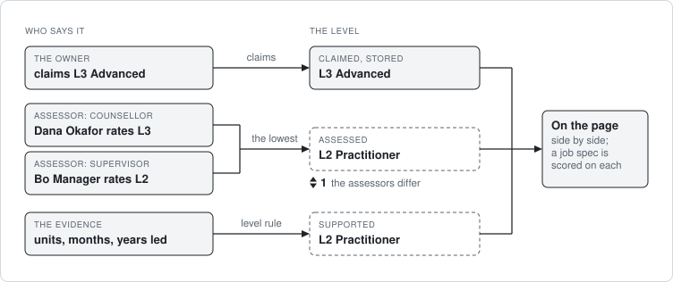
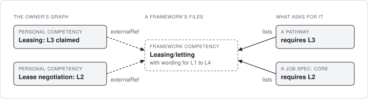
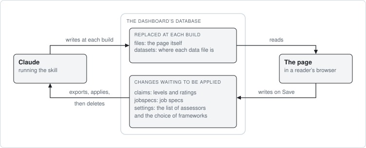

# competency-graph

A Claude Code plugin that helps one person build and keep a **competency graph**: what they know, and the evidence that proves it.

The graph is a folder of plain markdown notes that the owner controls (an Obsidian vault or any folder, often a git repository). Claude proposes, the owner decides, and every claim can be traced back to a job, a project, a credential or another record the owner already has.

## What it does

- **Maps competencies** into a tree organised by discipline, with industry sectors kept as a separate axis.
- **Links evidence** (jobs, engagements, projects, repositories, credentials, courses, publications, activities) to the competencies it demonstrates.
- **Works out the level the evidence supports**, from L1 Aware to L4 Expert, and compares it with the level the owner claims.
- **Flags** claims above their evidence, stale evidence and claims that stand above a prerequisite.
- **Measures the graph against frameworks**: professional bodies' competency frameworks and the owner's own.
- **Scores the graph against a role** through job specs made of framework competencies.
- **Records another person's rating** (a supervisor, counsellor or manager) beside the owner's own.
- **Builds a dashboard** for claude.ai from the owner's files.
- **Pulls the evidence behind a competency** for a CV, an application or an interview, respecting what may be disclosed.

## How it works

These drawings are the ones on the dashboard's own *How this works* tab.

### Three parts, and only one of them is the record

Your files are the record. The skill is what Claude runs. The dashboard is a display. Information moves between them in a loop, and every step that changes the record goes through Claude and is approved by you.

<picture>
  <source media="(prefers-color-scheme: dark)" srcset="docs/images/three-parts-dark.svg">
  
</picture>

The notes are the record and the page is a snapshot of them. A change made on the page reaches the notes only through steps 4 and 5. If the dashboard were deleted, it could be rebuilt from the files.

### The graph: notes and the links between them

The graph is made of three kinds of note and a handful of named links.

| Note | One for each | What it records |
|---|---|---|
| Competency | Thing you know or can do, from a whole domain down to a single method or tool | Its parent in the tree, its kind, the level you claim, and the framework competencies it answers to |
| Sector | Industry you have worked in | Its code in a standard industry classification |
| Evidence | Job, engagement, project, credential, publication, course or ongoing activity | Its dates, organisation and sector, the competencies it demonstrates, and which of them you led |

<picture>
  <source media="(prefers-color-scheme: dark)" srcset="docs/images/graph-dark.svg">
  
</picture>

Each arrow is a link written in the note it starts from. The tree is organised by discipline, what you do. The sector, where you did it, is a separate axis reached through the evidence, so competencies that carry from one industry to another stay visible.

### Where the evidence comes from

Nothing in the graph is typed from memory. It is drawn from records you already have, in six steps.

| Step | Who | What happens |
|---|---|---|
| 1. Names the sources | You | CVs, job write-ups, credential lists, repositories, publications. Each is marked: becomes evidence, read only, or ignored |
| 2. Collects candidates | Claude | Reads the sources in full and lists candidate competencies, each with the file and section it came from |
| 3. Decides the domains | You | The candidates are grouped into a few domains named by discipline. Nothing is placed until these are agreed |
| 4. Approves placements | You | One domain at a time, Claude proposes each competency's parent and kind and the evidence links, as a table to approve |
| 5. Writes the notes | Claude | Competency and sector notes are created. An existing job file gains fields; its own text is not touched |
| 6. Checks the result | A script | The checker must find no errors, and the graph must answer one real question of yours before the next domain |

### From evidence to a supported level

A supported level is never typed in. A script reads every note and works it out, the same way each time.

<picture>
  <source media="(prefers-color-scheme: dark)" srcset="docs/images/supported-level-dark.svg">
  
</picture>

Two projects inside one job make one unit, not three. Here the work was led at two organisations but for under five years, so the evidence supports L2 Practitioner while the note claims L3 Advanced.

| Level | What it means | What the evidence must show |
|---|---|---|
| L1 Aware | Understands it; has not delivered it | Nothing: a claim of L1 needs no evidence |
| L2 Practitioner | Delivers it independently | Delivered work adding up to six months or more |
| L3 Advanced | Leads complex work and is accountable for it | Two or more units of led work, at two or more organisations or with an anchor a third party can check, over five led years or more |
| L4 Expert | A recognised authority beyond their own team | Ten or more led years, and at least one kind of outside recognition |

The thresholds are defaults you can change. Old evidence is reported as stale but never lowers a level.

### Claimed, assessed and supported

A competency can carry three levels, each from a different source. None of them overwrites another, and the differences between them are what the graph is for.

<picture>
  <source media="(prefers-color-scheme: dark)" srcset="docs/images/three-readings-dark.svg">
  
</picture>

Solid boxes are written down by a person; dashed ones are worked out. Each assessor rates without seeing the other's rating.

### Frameworks and job specs

A framework is a published list of competencies: a professional body's, or one you wrote. The graph is never reshaped to fit one. A personal competency names each framework competency it answers to, and pathways and job specs ask for it by that name.

<picture>
  <source media="(prefers-color-scheme: dark)" srcset="docs/images/frameworks-and-job-specs-dark.svg">
  
</picture>

Where several personal competencies name one framework competency, the highest level among them is the level held. Every framework is restated on L1 to L4 before it enters the library, so everything is on one scale.

### The dashboard is a display

One script reads the notes and writes everything the dashboard needs. A change you make on the page (a claimed level, an assessor's rating, a job spec) waits in the dashboard's own database until Claude writes it into your files.

<picture>
  <source media="(prefers-color-scheme: dark)" srcset="docs/images/dashboard-database-dark.svg">
  
</picture>

| Step | Who | What happens |
|---|---|---|
| 1. Changes a value | A reader | A level, an assessor's rating or a job spec is changed. It shows as unsaved and has not left the browser |
| 2. Saves it | A reader | Each change becomes one small document in the dashboard's database. It can still be withdrawn |
| 3. Exports what waits | Claude | You ask Claude to apply the dashboard changes, and Claude reads the waiting documents |
| 4. Plans a dry run | A script | The changes become a plan, which the link editor runs without writing, checking every note and value |
| 5. Writes the notes | A script | The plan is applied and the checker runs. A competency not yet in the graph is proposed to you first |
| 6. Rebuilds the page | Claude | The applied documents are cleared, the data files are rebuilt and uploaded, and the page shows the new record |

## Install

Add this repository as a marketplace, then install the plugin:

```
/plugin marketplace add reggiechan74/competency-graph
/plugin install competency-graph@competency-graph
```

To try a local copy, point the marketplace at the folder instead:

```
/plugin marketplace add /path/to/competency-graph
```

### Requirements

- Python 3 with PyYAML (`pip install pyyaml`). Claude asks before installing it.
- Nothing else is needed to build and check a graph.
- The dashboard needs a claude.ai account with the Dashboard artifact type.

## Use

Start a new graph:

```
/competency-graph:competency-graph --buildnew
```

Or just ask, for example:

- "Turn my resume folder into a competency graph."
- "Add my new contract to the graph."
- "What supports my claim for leasing?"
- "Which of my claims are stale or unsupported?"
- "How do I measure up against this job ad?"
- "Build my dashboard."

Claude asks where your records are, proposes domains and placements for you to approve, and creates no note until you have approved its place.

## Where your files go

Your graph lives in your own files, never in this plugin. A `competency-graph.yaml` file records where everything is saved.

| Where you start | Default location |
|---|---|
| Inside a git repository | `Competency_Graph/` at the repository's root |
| Anywhere else | `Competency_Graph/` in your Documents folder |

You can choose any other place. `kg_config.py where` prints the default for the folder you are in.

## What is in the plugin

Everything is under `skills/competency-graph/`:

| Folder | What it holds |
|---|---|
| `SKILL.md` | The method Claude follows, and the ground rules |
| `references/` | The specification, templates, onboarding, the dashboard guide, how to record a job |
| `scripts/` | The checker, queries, the safe link editor, worksheets, the summary and dashboard builders, and their tests |
| `assets/frameworks/` | The framework library |
| `assets/dashboard/` | The dashboard page and its design notes |
| `evals/` | Test cases for the skill itself |

## The framework library

| Framework | Source | Status |
|---|---|---|
| RICS APC | Royal Institution of Chartered Surveyors, December 2025 guides | Restated on L1 to L4 |
| CFA CBOK | CFA Institute, 2027 curriculum topic weights | Restated on L1 to L4 |
| ASQ CSSGB | ASQ, 2022 Six Sigma Green Belt Body of Knowledge | Restated on L1 to L4 |
| Chan AFSE, Chan AGEN, Chan CXMDS | The author's own role frameworks | Drafts, under review |

The first three are drawn from those bodies' published guides, which remain theirs (see `NOTICE.md`). Check a framework against its current guide before relying on it: bodies revise them every few years. `catalog.yaml` lists each framework's sources and how its levels were mapped.

## Versions

Three things carry a version, and they move separately:

| What | Version | Where it is recorded |
|---|---|---|
| This plugin | 0.1.1 | `.claude-plugin/plugin.json`, `CHANGELOG.md` |
| The specification (the graph's fields and rules) | 0.5 | `references/specification.md` |
| The dashboard page | 1.7.2 | `assets/dashboard/DESIGN.md` |

## Development

Run the tests from the skill's scripts folder:

```
cd skills/competency-graph/scripts
python3 -m pytest tests -q
```

The dashboard page's tests need Node with jsdom, and Playwright with Chromium; each is skipped when its tool is missing. Before publishing a change to the page, also render it under the Dashboard type's real stylesheet (`scripts/tests/render_page.py`, described in `assets/dashboard/DESIGN.md`).

The drawings in this README are exported from the dashboard page, where they are drawn once. After changing one there, run `python3 tools/export_figures.py` to rewrite `docs/images/` (`--check` exits 1 if the files are out of date).

## Status

The method and the dashboard were built and proven on the author's own graph. The plugin's first release outside that repository was 0.1.0; `CHANGELOG.md` lists what has changed since.

## Licence

MIT, for the author's own work: see `LICENSE`.

The framework library also includes material from RICS, CFA Institute and ASQ, included for convenience. It remains theirs and the MIT licence does not cover it. `NOTICE.md` says exactly which material that is, lists the published ideas the method draws on, and gives the licence of the one bundled library (D3, used by the tests).
